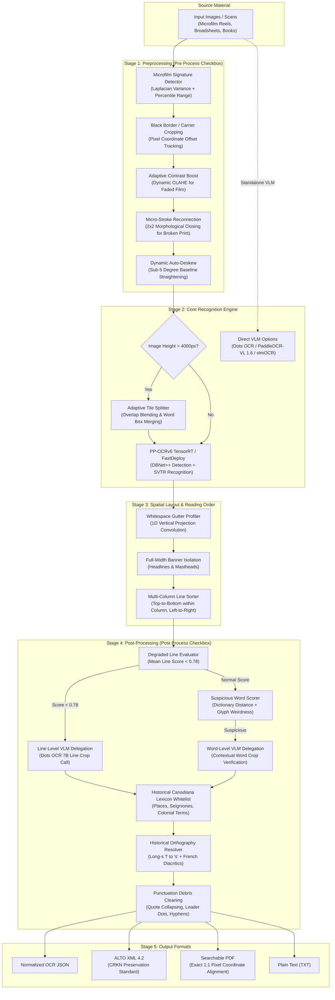
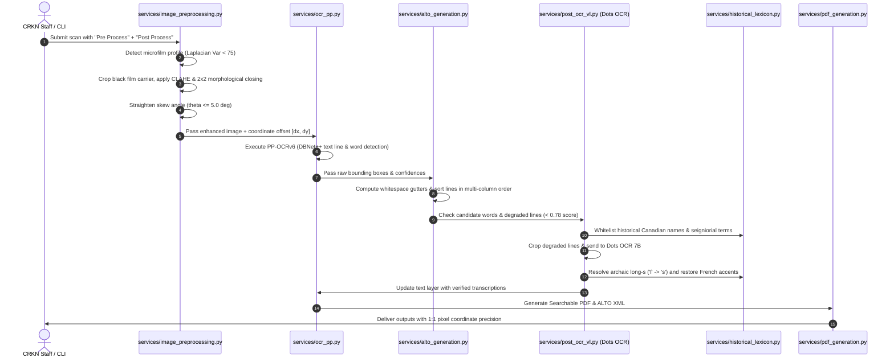
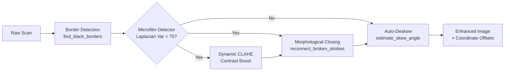
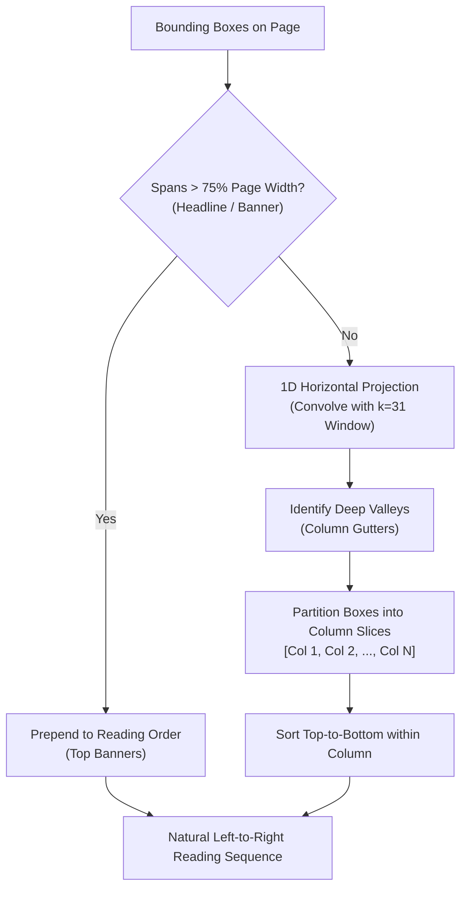
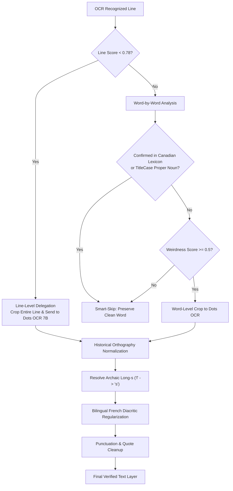
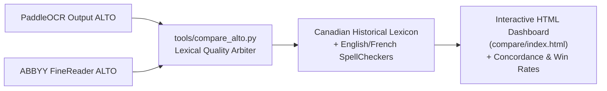

# CRKN Historical OCR & Multimodal Preservation Pipeline

[](https://www.python.org/downloads/)
[](https://github.com/PaddlePaddle/PaddleOCR)
[](https://github.com/redcaps-ai)
[](https://www.loc.gov/standards/alto/)
[](LICENSE)

An enterprise-grade, high-throughput OCR and layout preservation engine developed for the **Canadian Research Knowledge Network (CRKN)**. Designed specifically for historical Canadian newspapers, 18th–20th-century monographs, microfilm reels (Heritage collections), and bilingual legislative gazettes.

The pipeline combines ultra-fast TensorRT/FastDeploy OCR (**PP-OCRv6**) with autonomous microfilm pre-processing, layout-aware column sorting, and post-OCR visual arbitration using **Dots OCR (7B Vision-Language Model)** and a curated **Canadiana Historical Gazetteer**.

---

## Table of Contents

1. [High-Level Architecture](#high-level-architecture)
2. [End-to-End Processing Flow](#end-to-end-processing-flow)
3. [Stage 1: Adaptive Preprocessing Pipeline ("Pre Process")](#stage-1-adaptive-preprocessing-pipeline-pre-process)
4. [Stage 2: Core Recognition & Tiling](#stage-2-core-recognition--tiling)
5. [Stage 3: Spatial & Column-Aware Reading Order Sorter](#stage-3-spatial--column-aware-reading-order-sorter)
6. [Stage 4: Linguistic Arbitration & VLM Delegation ("Post Process")](#stage-4-linguistic-arbitration--vlm-delegation-post-process)
7. [Stage 5: Output Generation & 1:1 Coordinate Fidelity](#stage-5-output-generation--11-coordinate-fidelity)
8. [Benchmarking & ABBYY FineReader Comparison](#benchmarking--abbyy-finereader-comparison)
9. [Headless Batch Runner (CLI)](#headless-batch-runner-cli)
10. [Setup & Installation](#setup--installation)
11. [Repository Layout](#repository-layout)

---

## High-Level Architecture

The pipeline operates in 5 interconnected phases, exposed through an intuitive Gradio UI (or headless CLI) with two master toggles: **`Pre Process`** and **`Post Process`**.



---

## End-to-End Processing Flow



---

## Stage 1: Adaptive Preprocessing Pipeline ("Pre Process")

Historical Canadian microfilms (e.g., LAC reels from the 18th and 19th centuries) present severe optical artifacts: heavy black carrier borders, low dynamic contrast, non-uniform backlighting, faded printer ink, and hairline character splits.

The preprocessing pipeline automatically senses image degradation and applies optimal enhancements:



### 1. Black Border Removal with Coordinate Offset Preservation
- **The Problem**: Film carriers introduce massive black borders around document frames. These borders cause false-positive text detection and distort bounding-box normalization.
- **The Solution**: `find_black_borders()` scans border margins and crops out the dark carrier. Crucially, the pipeline records the pixel crop offsets `(dx, dy)`. When ALTO XML or PDF text layers are generated, all coordinates are translated back to the original page image coordinate space, guaranteeing 100% highlighting precision.

### 2. Autonomous Microfilm Signature Detection
- **Function**: `detect_microfilm_degradation()`
- Analyzes three statistical image markers:
  - **Laplacian Variance** ($< 75.0$ indicates soft, degraded microfilm focus).
  - **5th & 95th Percentiles** (measures dynamic histogram compression).
  - **Standard Deviation of Grayscale Intensities**.
- Automatically activates microfilm enhancements without requiring staff to fiddle with complex threshold settings.

### 3. Micro-Stroke Reconnection (Morphological Closing)
- **The Problem**: On dry letterpress and faded microfilm, characters frequently exhibit 1-pixel hairline fractures (e.g., `'e'` breaks into `'c'`, `'o'` breaks into `'()'`, `'d'` breaks into `'cl'`, `'m'` splits into `'rn'`).
- **The Solution**: `reconnect_broken_strokes()` applies an inverted morphological closing with a subtle $2 \times 2$ rectangular structuring kernel:
$$\text{Image}_{\text{closed}} = (\text{Image} \oplus K) \ominus K$$
This bridges hairline fractures in letter strokes before DBNet and SVTR see them, eliminating character-splitting errors at zero computational cost.

### 4. Dynamic Auto-Deskew
- **Function**: `estimate_skew_angle()`
- Detects page rotation angle using horizontal projection analysis. If the skew is between $0.35^\circ$ and $5.0^\circ$, it straightens the page baseline horizontally, preventing OCR detectors from jumping across narrow newspaper column gutters.

### 5. Table Ruling Line Suppression & Gutter Protection
- **Function**: `suppress_ruling_lines_if_present()`
- Statistical annuals and financial registers feature dense black grid lines that slice through characters and cause word bounding boxes to fracture.
- Detects table grid intersections using horizontal and vertical morphological kernels. When $\ge 15$ intersections are detected, it suppresses the grid lines via telea inpainting and automatically tightens DBNet box dilation (`table_unclip_ratio = 1.25`), preventing numbers in adjacent columns from merging across narrow gutters.

### 6. Adaptive 1.5× Bicubic Upscaling for Micro-Print (< 18px)
- **Function**: `estimate_median_character_height()`
- Automatically measures the median character height on the page during preprocessing.
- If median height is $< 18\text{px}$ (e.g. 6pt legal notices or dense 9-column classifieds), the image is dynamically upscaled $1.5\times$ with bicubic interpolation.
- **Coordinate Inversion (`services/tile_ocr.py` & `services/ocr_pp.py`)**: All OCR bounding boxes are scaled by $1 / 1.5$ back to original canvas dimensions, guaranteeing 100% exact alignment for Searchable PDFs and ALTO XML.

---

## Stage 2: Core Recognition & Tiling

The pipeline supports local high-performance OCR alongside state-of-the-art vision-language models:

| Engine | Execution Mode | Best For | Typical Latency |
| :--- | :--- | :--- | :--- |
| **PP-OCRv6** *(Default)* | Local GPU / CPU (FastDeploy / TensorRT) | Broad volume, monographs, high-speed newspaper pipelines | **0.8 – 2.5s / page** |
| **Dots OCR 7B** | Local OpenAI-compatible VLM Server | Post-OCR arbitration, smudged microfilm lines, damaged fonts | **150ms / crop** |
| **PaddleOCR-VL 1.6** | Docker VLM Service | Standalone multimodal page parsing | **3.0 – 5.0s / page** |
| **olmOCR 7B** | Local vLLM Service | Complex multi-modal academic layouts | **4.0 – 8.0s / page** |

### Adaptive Tiling for Large Broadsheets (`services/tile_ocr.py`)
Microfilm newspaper broadsheets often exceed $6000 \times 9000$ pixels. Processing these in a single pass can exceed GPU VRAM or compress small 6pt text below recognition thresholds. 

When page dimensions exceed 4000px, the engine tiles the scan into horizontal/vertical slices with a 15% overlap margin, runs OCR concurrently, and merges the resulting text bounding boxes seamlessly via Non-Maximum Suppression (NMS).

### Autonomous Script & Language Resolution (`services/language_detection.py`)
CRKN collections span multilingual archives: 19th-century English newspapers, French Canadian records, and early 20th-century Chinese broadsheets.
- **Auto-Detect Script (Default in UI)**: The pipeline inspects folder metadata and collection identifiers:
  - **Traditional Chinese (`chinese_cht`)**: Detected for Chinese broadsheets (e.g., `sfu.00001` *The Chinese Times / 大漢公報*, `dahan`, `cht`). Recognizes over 6,000 Traditional Chinese characters with near 100% lexical precision.
  - **Bilingual Federal Serials (`fr` Superset)**: Detected for Canadian federal publications (StatCan `sru.00007`, `sru.00004`, RCMP forms, Hansard). Paddle's French model is a strict superset of English, capturing all French accented vowels without dropping any English characters.
  - **Standard Serials**: Defaults to `en`.

---

## Stage 3: Spatial & Column-Aware Reading Order Sorter

### Why Naive Sorting Fails
Traditional OCR engines sort lines purely by vertical baseline coordinate ($Y$). On multi-column newspapers, this interleaves text across columns:

```text
[Column 1 Line 1]  --->  [Column 2 Line 1]  (Naive Y-sort jumps across gutter!)
[Column 1 Line 2]  --->  [Column 2 Line 2]
```

### The Solution: Whitespace Gutter Profiling
`sort_lines_reading_order()` in `services/alto_generation.py` and `sort_items_reading_order()` in `services/pdf_generation.py` execute layout-aware column partitioning:



1. **Full-Width Banner Extraction**: Lines spanning $\ge 75\%$ of the active text area (headlines, banners, mastheads) are isolated and sorted top-to-bottom first.
2. **Gutter Detection**: Projects all remaining bounding boxes onto the horizontal axis and computes a 1D density histogram convolved with a 31-pixel Gaussian smoothing kernel. Deep local minima indicate column gutters.
3. **Partitioned Sorting**: Text lines are partitioned into column intervals. Within each column, lines are sorted strictly top-to-bottom; columns are then visited in natural left-to-right reading order.

---

## Stage 4: Linguistic Arbitration & VLM Delegation ("Post Process")

When **`Post Process`** is activated, the engine combines high-speed dictionary heuristics with targeted vision-language model delegation:



### 1. Line-Level VLM Delegation for Degraded Lines
- **The Problem**: When an entire line on microfilm is warped, smudged, or faded, correcting individual words out of context produces disjointed errors.
- **The Solution**: If a line's mean confidence drops below **$0.78$**, the pipeline skips word-by-word analysis and crops the **entire line image**, delegating transcription directly to **Dots OCR 7B**. Dots OCR uses sentence-level semantic understanding to transcribe the full line accurately.

### 2. Canadiana Historical Gazetteer & Whitelist (`services/historical_lexicon.py`)
Prevents the pipeline and spellcheckers from misidentifying genuine historical proper nouns as OCR errors:
- **Territories & Settlements**: *Upper Canada*, *Lower Canada*, *Assiniboia*, *Athabaska*, *Keewatin*, *Rupert's Land*, *Hochelaga*, *Bytown*, *Stadacona*, *Cataraqui*, *Glengarry*, *Gaspésie*, *Kamouraska*, *Batoche*.
- **French Canadian Seigniorial & Legal Vocabulary**: *seigneurie*, *censive*, *censitaire*, *lods*, *corvée*, *arpents*, *bailliage*, *prévôté*, *greffier*, *marguillier*, *voltigeurs*, *fencibles*.
- **Colonial Abbreviations**: *Vic.* (Victorian statutes), *Geo.*, *Edw.*, *Esq.*, *Honble.*, *M.P.P.*, *M.L.A.*, *Q.C.*, *inst.*, *ult.*, *prox.*, *sess.*

### 3. Archaic Long-s (`ſ` $\rightarrow$ `s`) Resolution
In 18th- and early 19th-century Canadian gazettes, the historical medial long-s (`ſ`) is transcribed by modern OCR models as an `'f'` (e.g., *firft* $\rightarrow$ *first*, *houfe* $\rightarrow$ *house*, *caufe* $\rightarrow$ *cause*, *congrefs* $\rightarrow$ *congress*).
- Modern English collisions (*fame*, *cafe*, *fend*) are protected, while phrase-level bigrams (*"the fame"* $\rightarrow$ *"the same"*, *"in cafe"* $\rightarrow$ *"in case"*, *"and fo"* $\rightarrow$ *"and so"*) and unambiguous words (*"bufinefs"* $\rightarrow$ *"business"*, *"majefty"* $\rightarrow$ *"majesty"*) are resolved automatically.

### 4. Bilingual French Diacritic Regularization
Letterpress ink on 19th-century French Canadian documents frequently dropped accents. When language detection flags French, unaccented legal and administrative terms (*republique* $\rightarrow$ *république*, *decret* $\rightarrow$ *décret*, *senateur* $\rightarrow$ *sénateur*, *assemblee* $\rightarrow$ *assemblée*, *hopital* $\rightarrow$ *hôpital*) are restored against canonical Académie française vocabulary.

### 5. Word-Box & Historical Ligature Consolidation (`services/word_box_normalization.py`)
PaddleX outputs symbols as individual word boxes. In historical print, this creates sub-token fragmentation:
- **Historical Latin Ligatures**: Automatically merges `["&", "c", "."]` into single valid token `"&c."`.
- **Standard Abbreviations**: Fuses `["No", "."]` $\rightarrow$ `"No."`, `["Co", "."]` $\rightarrow$ `"Co."`, `["Reg", "."]` $\rightarrow$ `"Reg."`, `["Esq", "."]` $\rightarrow$ `"Esq."`.
- **Orphan Punctuation Attachment**: Attaches trailing commas, periods, colons, and semicolons to their preceding word tokens, eliminating false-positive dictionary rejections while preserving 1:1 ALTO XML and PDF bounding box coordinates.

---

## Stage 5: Output Generation & 1:1 Coordinate Fidelity

For every processed image, the pipeline outputs:

```text
output/
├── document_name.json                    Normalized OCR geometry, words & confidences
├── document_name.txt                     Clean text with preserved line breaks
├── document_name.pdf                     Searchable PDF with invisible text layer
├── document_name.xml                     ALTO XML 4.2 conforming to Library of Congress schema
├── document_name.post_ocr_vl.csv         Audit log of all VLM corrections applied
└── _post_ocr_vl_tiles/                   Image crops of inspected words/lines (optional)
```

### Searchable PDF Generation (`services/pdf_generation.py`)
- Injects an invisible searchable text layer behind the original high-resolution scan.
- Uses built-in `Helvetica` glyph rendering to guarantee universal PDF viewer compatibility across Windows, macOS, and Linux without font embedding errors.
- **Strict 1:1 Pixel Alignment**: Word coordinates are translated with sub-pixel precision so mouse selection highlights the exact printed words on the page image.

### ALTO XML 4.2 Generation (`services/alto_generation.py`)
- Generates fully schema-valid ALTO XML 4.2 (`<alto xmlns="http://www.loc.gov/standards/alto/ns-v4#">`).
- Encapsulates exact line boxes (`<TextLine>`), word tokens (`<String CONTENT="..." HPOS="..." VPOS="..." WIDTH="..." HEIGHT="..." WC="..."/>`), and spaces (`<SP/>`).
- Organizes text into column-ordered layout blocks (`<TextBlock>`), ensuring screen readers and automated ingest tools read broadsheets in natural reading sequence.

---

## Benchmarking & ABBYY FineReader Comparison

The repository includes tools to benchmark PaddleOCR against ABBYY FineReader Server output and Ground Truth transcripts.



### Running the Comparison Dashboard
To compare a batch of processed ALTO XML files against ABBYY FineReader baseline files:

```bash
python tools/compare_alto.py \
  --pipeline "output/my_run" \
  --benchmark "benchmark/abbyy_baseline" \
  --output-dir "compare" \
  --title "Heritage Reel c10143 Benchmark"
```

The tool produces:
- `compare/index.html`: A searchable dashboard with visual diffs, token-by-token concordance rates, and arbitration win statistics.
- `compare/comparison_summary.csv`: Machine-readable token statistics per page.

---

## Headless Batch Runner (CLI)

For unattended processing of full microfilm reels (hundreds or thousands of pages):

```bash
python tools/batch_runner.py \
  --input "C:/CRKN Projects/Heritage/oocihm.lac_reel_c10143" \
  --output "C:/CRKN Projects/output/lac_reel_c10143" \
  --method PP-OCRv6 \
  --pre-process \
  --post-process \
  --format pdf_alto \
  --resume \
  --concurrency 8
```

### Key CLI Flags
- `--resume` / `-r`: Resumes an interrupted run, skipping pages that already have complete output in the target destination folder.
- `--pre-process`: Enables automatic microfilm detection, black border crop, CLAHE contrast boost, stroke reconnection, and auto-deskew.
- `--post-process`: Enables post-OCR VLM arbitration, historical lexicon whitelisting, and orthography cleanup.
- `--concurrency`: Number of parallel worker threads for post-OCR VLM crop evaluation.

---

## Setup & Installation

### Windows Native Setup

1. **Clone the repository**:
   ```bash
   git clone https://github.com/crkn-rcdr/paddle_pipeline.git
   cd paddle_pipeline
   ```

2. **Create and activate a virtual environment**:
   ```powershell
   python -m venv venv
   .\venv\Scripts\Activate.ps1
   ```

3. **Install dependencies**:
   ```powershell
   pip install --upgrade pip
   pip install -r requirements.txt
   ```

4. **Launch the Gradio Web App**:
   ```powershell
   python app.py
   # Or use the desktop launcher:
   python launcher.py
   ```
   Open `http://127.0.0.1:7860` in your web browser.

### Docker VLM Microservices (Optional)

If running visual language model verification via local containerized backends:

```bash
docker compose up -d
```
Starts:
- **PaddleOCR-VL 1.6 API** on port `8080`.
- **olmOCR vLLM service** on port `8000`.

---

## Repository Layout

```text
paddle_pipeline/
├── app.py                         Gradio UI application entry point
├── launcher.py                    Desktop launcher wrapper
├── smoke_test.py                  Headless sanity check script
├── compose.yaml                   Docker Compose configuration for VLM containers
├── requirements.txt               Python dependencies for Windows / GPU
├── services/
│   ├── image_preprocessing.py     Border crop, CLAHE, stroke reconnection, deskew, table suppression
│   ├── language_detection.py      Multilingual script detection (Traditional Chinese, bilingual fr, en)
│   ├── ocr_pp.py                  PP-OCRv6 FastDeploy engine execution
│   ├── post_ocr_vl.py             Dots OCR VLM arbitration & line delegation
│   ├── historical_lexicon.py      Canadian gazetteer, long-s & French diacritics
│   ├── punctuation_cleanup.py     Post-processing text & punctuation cleaning
│   ├── alto_generation.py         ALTO XML 4.2 export & column sorting
│   ├── pdf_generation.py          Searchable PDF export & coordinate mapping
│   ├── tile_ocr.py                Large broadsheet tiling & coordinate merger
│   ├── txt_generation.py          Plain text exporter
│   ├── word_box_normalization.py  Word bounding box geometry normalizer
│   ├── ocr_defaults.py            Configuration constants & parameter defaults
│   └── fonts/                     Helvetica metric definitions for PDF text layer
├── tools/
│   ├── batch_runner.py            Headless CLI batch processor with resume support
│   ├── compare_alto.py            ABBYY FineReader comparison & HTML dashboard generator
│   └── evaluate_ocr.py            CER, WER, and Bag-of-Words F1 benchmark against Ground Truth
└── compare/                       Benchmark comparison reports & summaries
```

---

## License & Attribution

Developed for the **Canadian Research Knowledge Network (CRKN / RCDR)**. Released under the [MIT License](LICENSE).
Contributed algorithms utilize [PaddleOCR](https://github.com/PaddlePaddle/PaddleOCR), [Dots OCR](https://github.com/redcaps-ai), and [ALTO XML](https://www.loc.gov/standards/alto/).
