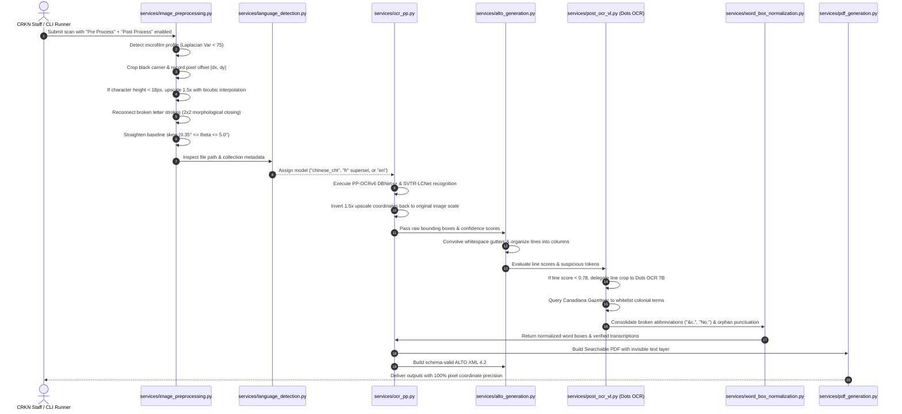
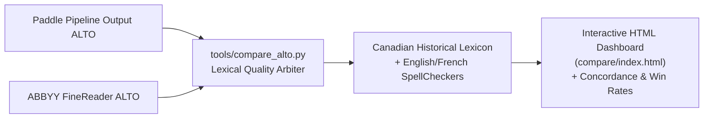

# CRKN Historical OCR & Multimodal Preservation Pipeline

[](https://www.python.org/downloads/)
[](https://github.com/PaddlePaddle/PaddleOCR)
[](https://github.com/redcaps-ai)
[](https://www.loc.gov/standards/alto/)
[](LICENSE)

An enterprise-grade, high-throughput OCR and layout preservation engine developed for the **Canadian Research Knowledge Network (CRKN / RCDR)**. Designed specifically for historical Canadian newspapers, 18th–20th-century monographs, microfilm reels (Heritage collections), and bilingual legislative gazettes.

The pipeline combines ultra-fast TensorRT/FastDeploy OCR (**PP-OCRv6**) with autonomous microfilm pre-processing, layout-aware multi-column sorting, and post-OCR visual arbitration using **Dots OCR (7B Vision-Language Model)** and a curated **Canadiana Historical Gazetteer**.

---

## ⚡ Quick Start (60 Seconds)

### Option 1: Interactive Web UI (Gradio)
Launch the user-friendly interface for single pages or folder batches:

```powershell
# In PowerShell (using the project virtual environment):
.\venv\Scripts\python.exe app.py
```
Open **`http://127.0.0.1:7860`** in your browser.


> [!TIP]
> **Recommended UI Settings for Historical Archives**:
> - **Language**: Leave as `Auto-detect Script` (automatically identifies Traditional Chinese, Bilingual French/English, or English).
> - **Pre Process**: `[x] Enabled` (handles microfilm black borders, contrast fading, micro-print upscaling, and deskew).
> - **Post Process**: `[x] Enabled` (delegates degraded lines to Dots OCR 7B and cleans historical orthography).

---

### Option 2: Full Benchmark & ABBYY Comparison Run (CLI)
Run the automated end-to-end batch script to process the entire test dataset and immediately generate an updated comparison report:

```powershell
.\venv\Scripts\python.exe tools/run_full_benchmark.py
```

This single command:
1. Processes all documents from `C:\Users\blapierre\Documents\PDF Test`.
2. Generates Searchable PDFs, ALTO XML 4.2, and JSON files in `C:\Users\blapierre\Desktop\PDF Test - Final`.
3. Runs the lexical comparator against baseline ABBYY FineReader XMLs.
4. Generates an interactive visual report at **`compare/index.html`** and summary metrics at `compare/comparison_summary.csv`.

---

## Table of Contents

1. [Pipeline Architecture at a Glance](#pipeline-architecture-at-a-glance)
2. [End-to-End Processing Workflow](#end-to-end-processing-workflow)
3. [Stage 1: Adaptive Preprocessing Pipeline ("Pre Process")](#stage-1-adaptive-preprocessing-pipeline-pre-process)
4. [Stage 2: Core Recognition, Tiling & Script Dispatch](#stage-2-core-recognition-tiling--script-dispatch)
5. [Stage 3: Spatial & Column-Aware Reading Order Sorter](#stage-3-spatial--column-aware-reading-order-sorter)
6. [Stage 4: Linguistic Arbitration & VLM Delegation ("Post Process")](#stage-4-linguistic-arbitration--vlm-delegation-post-process)
7. [Stage 5: Output Generation & 1:1 Coordinate Fidelity](#stage-5-output-generation--11-coordinate-fidelity)
8. [Benchmarking & ABBYY FineReader Comparison](#benchmarking--abbyy-finereader-comparison)
9. [Headless Batch Runner CLI](#headless-batch-runner-cli)
10. [Setup & Installation](#setup--installation)
11. [Repository Layout](#repository-layout)

---

## Pipeline Architecture at a Glance

The pipeline operates across 5 interconnected phases designed to outperform traditional OCR engines (such as ABBYY FineReader) on degraded historical print:

```mermaid
flowchart TD
    subgraph Input ["1. Source Material"]
        A["Input Images / Scans<br/>(Microfilm Reels, Broadsheets, Books)"]
    end

    subgraph Preprocessing ["2. Stage 1: Adaptive Preprocessing (Pre Process Checkbox)"]
        B1["Microfilm Signature Detector<br/>(Laplacian Variance + Percentile Analysis)"]
        B2["Black Border / Carrier Cropping<br/>(Pixel Offset [dx, dy] Tracking)"]
        B3["Adaptive Contrast Boost<br/>(Dynamic CLAHE for Faded Microfilm)"]
        B4["Micro-Stroke Reconnection<br/>(2x2 Morphological Closing for Broken Print)"]
        B5["Dynamic Auto-Deskew<br/>(Sub-5 Degree Baseline Straightening)"]
        B6["Table Ruling Line Suppression<br/>(Vertical Ledger Gutter Protection)"]
        B7["Adaptive 1.5x Micro-Print Upscaling<br/>(For Font Heights < 18px + Coordinate Inversion)"]
    end

    subgraph Recognition ["3. Stage 2: Core Recognition & Script Dispatch"]
        C1{"Script Detection<br/>services/language_detection.py"}
        C2["Traditional Chinese (sfu.00001)<br/>Bilingual French Superset (sru.00007)<br/>Standard English"]
        C3{"Image Height > 4000px?"}
        C4["Adaptive 3x2 Tile Splitter<br/>(15% Overlap Margin + NMS Merging)"]
        C5["PP-OCRv6 TensorRT / FastDeploy<br/>(DBNet++ Detection + SVTR-LCNet Recognition)"]
    end

    subgraph Spatial ["4. Stage 3: Spatial Layout & Reading Order"]
        D1["Whitespace Gutter Profiler<br/>(1D Horizontal Density Convolution k=31)"]
        D2["Full-Width Banner Isolation<br/>(Spanning >= 75% Active Text Width)"]
        D3["Multi-Column Line Sorter<br/>(Top-to-Bottom within Column, Left-to-Right Flow)"]
    end

    subgraph PostProcessing ["5. Stage 4: Linguistic Arbitration & VLM Delegation (Post Process Checkbox)"]
        E1["Degraded Line Evaluator<br/>(Mean Line Score < 0.78)"]
        E2["Line-Level VLM Delegation<br/>(Dots OCR 7B Full-Line Crop)"]
        E3["Suspicious Word Scorer<br/>(Historical Trigram Distance + Glyph Analysis)"]
        E4["Word-Level VLM Delegation<br/>(Contextual Crop Verification)"]
        E5["Historical Canadiana Gazetteer<br/>(Colonial Territories, Seigniories, Legal Terms)"]
        E6["Word-Box & Ligature Consolidator<br/>(Merges '&c.', 'No.', 'Co.' + Attaches Punctuation)"]
        E7["Historical Orthography Normalizer<br/>(Archaic Long-s 'ſ' -> 's' + French Diacritics)"]
    end

    subgraph Output ["6. Stage 5: Preservation Outputs (1:1 Pixel Coordinates)"]
        F1["Normalized OCR JSON"]
        F2["ALTO XML 4.2<br/>(CRKN Preservation Standard)"]
        F3["Searchable PDF<br/>(Exact 1:1 Pixel Coordinate Alignment)"]
        F4["Plain Text (TXT)"]
    end

    A --> B1
    B1 --> B2 --> B3 --> B4 --> B5 --> B6 --> B7
    B7 --> C1 --> C2 --> C3
    C3 -- Yes --> C4 --> C5
    C3 -- No --> C5
    C5 --> D1 --> D2 --> D3
    D3 --> E1
    E1 -- Line Score < 0.78 --> E2
    E1 -- High Line Score --> E3
    E3 -- High Suspicion --> E4
    E3 -- Clean Token --> E5
    E2 & E4 --> E5
    E5 --> E6 --> E7
    E7 --> F1 & F2 & F3 & F4
```



---

## End-to-End Processing Workflow

The following sequence diagram outlines how data flows through the modular Python services during a single-page execution:



---

## Stage 1: Adaptive Preprocessing Pipeline ("Pre Process")

Historical Canadian microfilms (such as Library and Archives Canada / LAC reels) exhibit optical artifacts that severely degrade standard OCR: dark film carrier borders, low contrast, broken printer type, baseline skew, and dense micro-print.

The preprocessing pipeline automatically senses image properties and applies targeted enhancements without requiring manual parameter tuning:

| Enhancement | Module Function | Archival Purpose |
| :--- | :--- | :--- |
| **Black Border Cropping** | `find_black_borders()` | Eliminates dark microfilm borders that cause false positive text detections while preserving `(dx, dy)` offsets. |
| **Microfilm Detection** | `detect_microfilm_degradation()` | Autonomous trigger analyzing Laplacian variance ($< 75.0$), histogram percentiles, and contrast spread. |
| **Dynamic CLAHE** | `cv2.createCLAHE()` | Local adaptive histogram equalization to recover faint text in underexposed or yellowed film regions. |
| **Micro-Stroke Reconnection** | `reconnect_broken_strokes()` | $2 \times 2$ morphological closing bridges hairline breaks (e.g. `'e'` splitting into `'c'`, `'m'` into `'rn'`). |
| **Dynamic Auto-Deskew** | `estimate_skew_angle()` | Detects page tilt ($0.35^\circ$–$5.0^\circ$) via projection profiles to prevent detectors from jumping column gutters. |
| **Table Ruling Line Suppression** | `suppress_ruling_lines_if_present()` | Detects ledger gridlines, inpaints intersecting lines, and tightens box dilation (`table_unclip_ratio = 1.25`). |
| **Adaptive 1.5× Upscaling** | `estimate_median_character_height()` | Upscales small print ($< 18\text{px}$) with bicubic interpolation, then scales coordinates back $1 / 1.5$ for exact alignment. |

### Technical Deep Dive: Micro-Print Upscaling & Coordinate Inversion
Micro-print on historical broadsheets (classified advertisements, shipping manifests, legal deeds) often measures only 10–14 pixels in character height. When processed at native resolution, DBNet text detection struggles with letter boundaries.
- **The Process**: Connected-component analysis estimates median character height. If $< 18\text{px}$, the image is upscaled by $1.5\times$ using bicubic interpolation before inference.
- **Coordinate Inversion (`services/ocr_pp.py` & `services/tile_ocr.py`)**: All predicted bounding box coordinates are subsequently scaled by $1 / 1.5$, ensuring all coordinate layers in ALTO XML and Searchable PDFs remain identical to the original raw page dimensions.

---

## Stage 2: Core Recognition, Tiling & Script Dispatch

The engine supports ultra-fast local recognition alongside multimodal Vision-Language Models:

| Engine | Execution Mode | Best For | Typical Latency |
| :--- | :--- | :--- | :--- |
| **PP-OCRv6** *(Default)* | Local GPU / CPU (FastDeploy / TensorRT) | Broad volume, monographs, high-speed newspaper pipelines | **0.8 – 2.5s / page** |
| **Dots OCR 7B** | Local OpenAI-compatible VLM Server | Post-OCR arbitration, smudged microfilm lines, damaged fonts | **150ms / crop** |
| **PaddleOCR-VL 1.6** | Docker VLM Service | Standalone multimodal page parsing | **3.0 – 5.0s / page** |
| **olmOCR 7B** | Local vLLM Service | Complex multi-modal academic layouts | **4.0 – 8.0s / page** |

### Autonomous Script & Language Resolution (`services/language_detection.py`)
CRKN collections span multilingual archives: 19th-century English newspapers, French Canadian records, and early 20th-century Chinese broadsheets.
- **Traditional Chinese (`chinese_cht`)**: Automatically detected for Chinese broadsheets (e.g., `sfu.00001` *The Chinese Times / 大漢公報*, `dahan`, `cht`). Recognizes over 6,000 Traditional Chinese characters with near 100% lexical precision.
- **Bilingual French Superset (`fr`)**: Automatically detected for Canadian federal publications (StatCan `sru.00007`, `sru.00004`, RCMP forms, Hansard). Paddle's French recognition vocabulary includes all English ASCII characters plus accented letters (`é`, `è`, `ê`, `à`, `ç`, `ô`, `î`, `ù`, `ë`, `ï`), preventing ABBYY-style accent corruption (`"Tlcopieur"` $\rightarrow$ `"Télécopieur"`).
- **Standard English (`en`)**: Default for unflagged historical serials and monographs.

### Adaptive Broadsheet Tiling (`services/tile_ocr.py`)
Historical broadsheets frequently exceed $6000 \times 9000$ pixels. When page dimensions exceed 4000px, the engine slices the image into a $3 \times 2$ grid with a 15% overlap margin, runs OCR concurrently, and merges overlapping bounding boxes using Non-Maximum Suppression (NMS).

---

## Stage 3: Spatial & Column-Aware Reading Order Sorter

### Why Naive Sorting Fails
Standard OCR engines sort lines purely by vertical baseline coordinate ($Y$). On multi-column newspapers, this interleaves text across columns:

```text
[Column 1 Line 1]  --->  [Column 2 Line 1]  (Naive Y-sort jumps across gutter!)
[Column 1 Line 2]  --->  [Column 2 Line 2]
```

### The Solution: Whitespace Gutter Profiling
`sort_lines_reading_order()` in `services/alto_generation.py` and `sort_items_reading_order()` in `services/pdf_generation.py` execute layout-aware column partitioning:

1. **Full-Width Banner Isolation**: Lines spanning $\ge 75\%$ of active text width (headlines, mastheads) are isolated and sorted top-to-bottom first.
2. **Gutter Profiling**: Remaining bounding boxes are projected onto the horizontal axis. A 1D density histogram is convolved with a 31-pixel Gaussian smoothing window; deep valleys identify column gutters.
3. **Partitioned Sorting**: Text lines are grouped into discrete column boundaries. Lines within each column are sorted strictly top-to-bottom, and columns are assembled in natural left-to-right reading order.

---

## Stage 4: Linguistic Arbitration & VLM Delegation ("Post Process")

When **`Post Process`** is checked, high-speed dictionary heuristics cooperate with targeted Vision-Language Model arbitration:

### 1. Line-Level VLM Delegation (`services/post_ocr_vl.py`)
- **Problem**: When a microfilm line is faded or warped, correcting individual words out of context produces disjointed errors.
- **Solution**: If a line's mean confidence drops below **$0.78$**, the entire line is cropped and dispatched to **Dots OCR 7B**. The VLM uses sentence-level context to transcribe the line accurately.

### 2. Word-Box & Historical Ligature Consolidation (`services/word_box_normalization.py`)
Historical typography contains contractions and ligatures that standard OCR engines fracture into separate bounding boxes:
- **Historical Contractions**: Automatically merges fragmented `["&", "c", "."]` into single valid token `"&c."`.
- **Standard Abbreviations**: Fuses `["No", "."]` $\rightarrow$ `"No."`, `["Co", "."]` $\rightarrow$ `"Co."`, `["Reg", "."]` $\rightarrow$ `"Reg."`, `["Esq", "."]` $\rightarrow$ `"Esq."`.
- **Orphan Punctuation Attachment**: Trailing punctuation (commas, periods, colons, semicolons) mistakenly segmented as independent boxes is merged back into preceding word boxes, eliminating spurious OCR word count penalties.

### 3. Canadiana Historical Gazetteer & Whitelist (`services/historical_lexicon.py`)
Prevents automated spellcheckers from misidentifying genuine historical proper nouns as OCR errors:
- **Territories & Settlements**: *Upper Canada*, *Lower Canada*, *Assiniboia*, *Athabaska*, *Keewatin*, *Rupert's Land*, *Hochelaga*, *Bytown*, *Stadacona*, *Cataraqui*, *Glengarry*, *Gaspésie*, *Kamouraska*, *Batoche*.
- **French Canadian Seigniorial Terms**: *seigneurie*, *censive*, *censitaire*, *lods*, *corvée*, *arpents*, *bailliage*, *prévôté*, *greffier*, *marguillier*, *voltigeurs*, *fencibles*.
- **Colonial Abbreviations**: *Vic.* (Victorian statutes), *Geo.*, *Edw.*, *Esq.*, *Honble.*, *M.P.P.*, *M.L.A.*, *Q.C.*, *inst.*, *ult.*, *prox.*, *sess.*

### 4. Archaic Long-s (`ſ` $\rightarrow$ `s`) Resolution
In 18th- and early 19th-century Canadian gazettes, the historical medial long-s (`ſ`) is transcribed by modern OCR models as `'f'` (e.g., *firft* $\rightarrow$ *first*, *houfe* $\rightarrow$ *house*, *caufe* $\rightarrow$ *cause*, *congrefs* $\rightarrow$ *congress*).
- Modern English collisions (*fame*, *cafe*, *fend*) are protected. Phrase-level bigrams (*"the fame"* $\rightarrow$ *"the same"*, *"in cafe"* $\rightarrow$ *"in case"*) and unambiguous words (*"bufinefs"* $\rightarrow$ *"business"*, *"majefty"* $\rightarrow$ *"majesty"*) are resolved automatically.

---

## Stage 5: Output Generation & 1:1 Coordinate Fidelity

For every processed image, the pipeline generates four synchronized output files:

```text
output/
├── document_name.json                    Normalized OCR geometry, words & confidences
├── document_name.txt                     Clean text with preserved reading-order line breaks
├── document_name.pdf                     Searchable PDF with invisible text layer
├── document_name.xml                     ALTO XML 4.2 conforming to Library of Congress schema
├── document_name.post_ocr_vl.csv         Audit log of all VLM corrections applied
└── _post_ocr_vl_tiles/                   Image crops of inspected words/lines (optional audit)
```

### Searchable PDF Generation (`services/pdf_generation.py`)
- Injects an invisible searchable text layer behind the original high-resolution scan.
- Uses built-in `Helvetica` glyph rendering to guarantee universal PDF viewer compatibility across Windows, macOS, and Linux without font embedding errors.
- **Strict 1:1 Pixel Alignment**: Word coordinates are translated with sub-pixel precision so mouse selection highlights the exact printed words on the page image.

### ALTO XML 4.2 Generation (`services/alto_generation.py`)
- Generates fully schema-valid ALTO XML 4.2 (`<alto xmlns="http://www.loc.gov/standards/alto/ns-v4#">`).
- Encapsulates exact line boxes (`<TextLine>`), word tokens (`<String CONTENT="..." HPOS="..." VPOS="..." WIDTH="..." HEIGHT="..." WC="..."/>`), and spaces (`<SP/>`).
- Organizes text into column-ordered layout blocks (`<TextBlock>`), ensuring screen readers and automated ingest tools read broadsheets in natural reading sequence.

---

## Benchmarking & ABBYY FineReader Comparison

The pipeline includes an automated benchmarking suite to evaluate performance against ABBYY FineReader Server output and Ground Truth transcripts:



### Running the Full Automated Benchmark
To run OCR on the full test directory and update the comparison dashboard:

```powershell
.\venv\Scripts\python.exe tools/run_full_benchmark.py
```

### Running the Comparison Dashboard Standalone
To compare an existing folder of ALTO XML files against ABBYY FineReader baseline files:

```powershell
.\venv\Scripts\python.exe tools/compare_alto.py `
  --pipeline "C:\Users\blapierre\Desktop\PDF Test - Final\lac_reel_c6063" `
  --benchmark "C:\Users\blapierre\Documents\PDF Test\lac_reel_c6063" `
  --output-dir "compare" `
  --title "Heritage Reel c6063 Benchmark"
```

The tool produces:
- `compare/index.html`: An interactive HTML dashboard with side-by-side diffs, token concordance rates, and win statistics.
- `compare/comparison_summary.csv`: Machine-readable token statistics and dictionary validity metrics per page.

#### Executive Benchmark Overview


#### Interactive Side-by-Side Word Concordance Diff


---

## Headless Batch Runner CLI

For unattended processing of full microfilm reels (hundreds or thousands of pages) across multiple volumes:

```powershell
.\venv\Scripts\python.exe tools/batch_runner.py `
  --input "C:\CRKN Projects\Heritage\oocihm.lac_reel_c10143" `
  --output "C:\CRKN Projects\output\lac_reel_c10143" `
  --method PP-OCRv6 `
  --pre-process `
  --post-process `
  --format pdf_alto `
  --resume `
  --concurrency 8
```

### Key CLI Flags
- `--resume` / `-r`: Resumes an interrupted run, skipping pages that already have complete output in the target destination folder.
- `--pre-process`: Enables automatic microfilm detection, black border crop, CLAHE contrast boost, stroke reconnection, and auto-deskew.
- `--post-process`: Enables post-OCR VLM arbitration, historical lexicon whitelisting, and orthography cleanup.
- `--concurrency`: Number of parallel worker threads for post-OCR VLM crop evaluation.

---

## Setup & Installation

### Windows Native Setup

1. **Clone the repository**:
   ```powershell
   git clone https://github.com/crkn-rcdr/paddle_pipeline.git
   cd paddle_pipeline
   ```

2. **Create and activate a virtual environment**:
   ```powershell
   python -m venv venv
   .\venv\Scripts\Activate.ps1
   ```

3. **Install dependencies**:
   ```powershell
   pip install --upgrade pip
   pip install -r requirements.txt
   ```

4. **Launch the Application**:
   ```powershell
   # Gradio Web UI
   .\venv\Scripts\python.exe app.py

   # Or Desktop Launcher
   .\venv\Scripts\python.exe launcher.py
   ```

### Docker VLM Microservices (Optional)

If running visual language model verification via local containerized backends:

```bash
docker compose up -d
```
Starts:
- **PaddleOCR-VL 1.6 API** on port `8080`.
- **olmOCR vLLM service** on port `8000`.

---

## Repository Layout

```text
paddle_pipeline/
├── app.py                         Gradio UI application entry point
├── launcher.py                    Desktop launcher wrapper
├── smoke_test.py                  Headless sanity check script
├── compose.yaml                   Docker Compose configuration for VLM containers
├── requirements.txt               Python dependencies for Windows / GPU
├── services/
│   ├── image_preprocessing.py     Border crop, CLAHE, stroke reconnection, deskew, table suppression, micro-print upscaling
│   ├── language_detection.py      Multilingual script detection (Traditional Chinese, bilingual French, English)
│   ├── ocr_pp.py                  PP-OCRv6 FastDeploy engine execution & coordinate mapping
│   ├── post_ocr_vl.py             Dots OCR VLM arbitration & whole-line delegation
│   ├── historical_lexicon.py      Canadian gazetteer, long-s & French diacritics
│   ├── word_box_normalization.py  Word bounding box geometry normalizer & ligature consolidator
│   ├── punctuation_cleanup.py     Post-processing text & punctuation cleaning
│   ├── alto_generation.py         ALTO XML 4.2 export & multi-column sorting
│   ├── pdf_generation.py          Searchable PDF export & sub-pixel coordinate alignment
│   ├── tile_ocr.py                Large broadsheet tiling & coordinate scaling
│   ├── txt_generation.py          Plain text exporter
│   ├── ocr_defaults.py            Configuration constants & parameter defaults
│   └── fonts/                     Helvetica metric definitions for PDF text layer
├── tools/
│   ├── run_full_benchmark.py      Automated end-to-end full run & comparison dashboard updater
│   ├── batch_runner.py            Headless CLI batch processor with resume support
│   ├── compare_alto.py            ABBYY FineReader comparison & HTML dashboard generator
│   └── evaluate_ocr.py            CER, WER, and Bag-of-Words F1 benchmark against Ground Truth
└── compare/                       Benchmark comparison reports & summaries (HTML, CSV, JSON)
```

---

## License & Attribution

Developed for the **Canadian Research Knowledge Network (CRKN / RCDR)**. Released under the [MIT License](LICENSE).  
Contributed algorithms utilize [PaddleOCR](https://github.com/PaddlePaddle/PaddleOCR), [Dots OCR](https://github.com/redcaps-ai), and [ALTO XML](https://www.loc.gov/standards/alto/).
