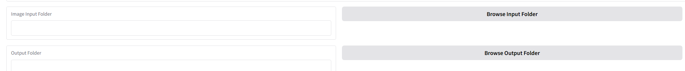
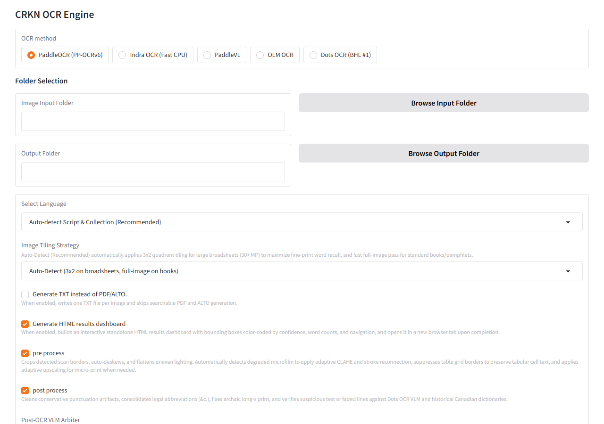
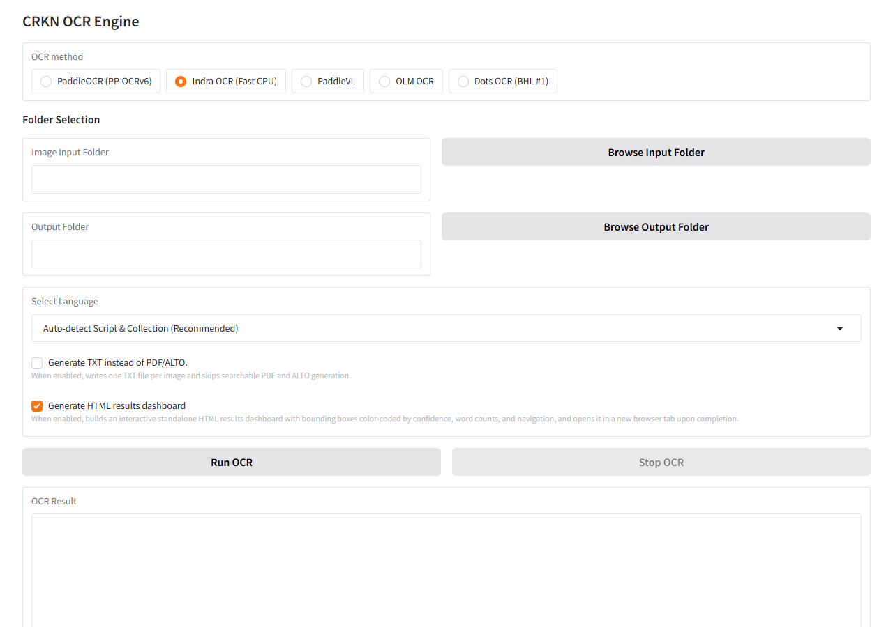
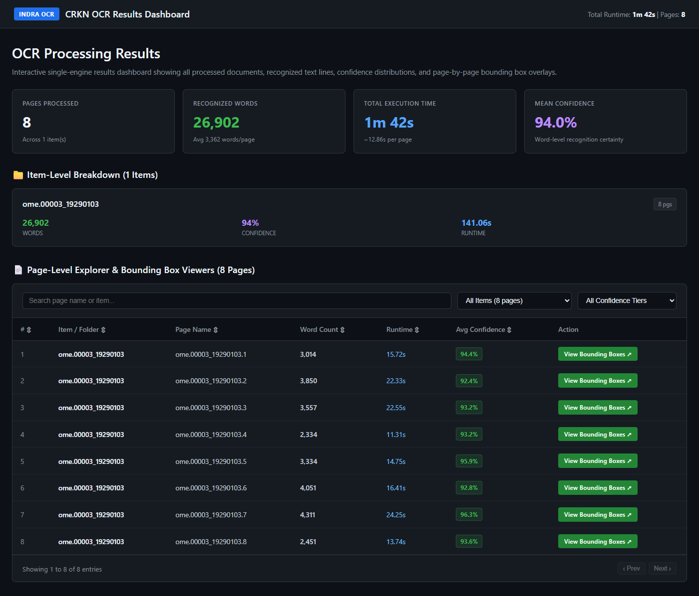
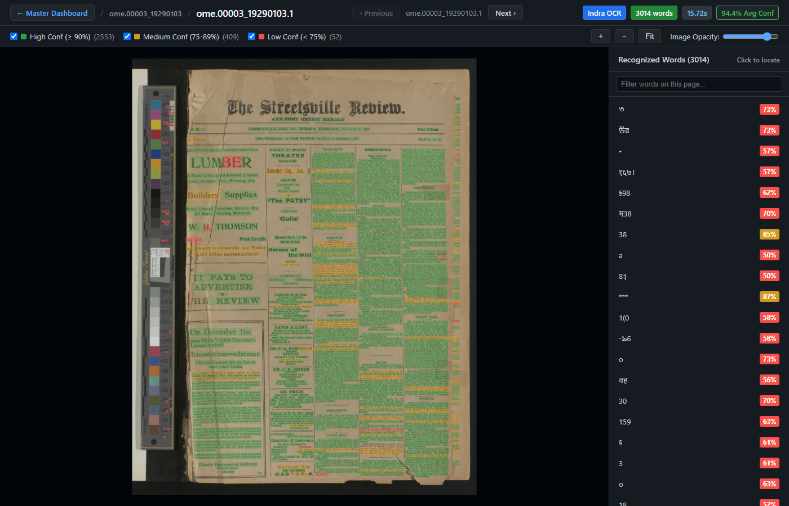
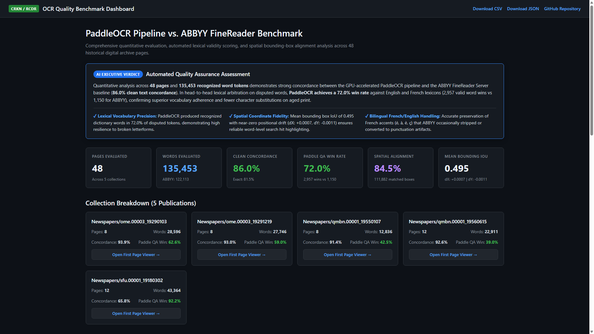
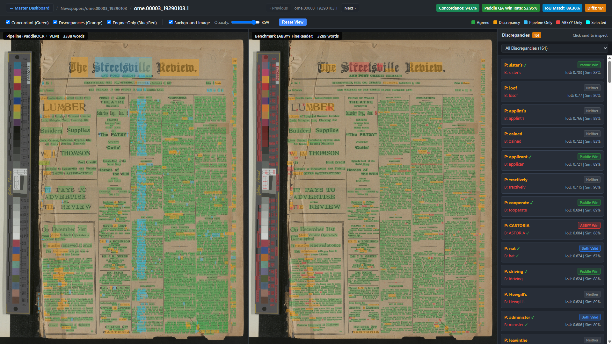

# CRKN OCR Tool User Guide

An intuitive, high-throughput OCR and layout preservation tool developed for the **Canadian Research Knowledge Network (CRKN / RCDR)**. 

---

## 🚀 Running OCR (Step-by-Step)

### Step 1: Launch the Application
Double-click **CRKN OCR Tool** on your desktop (or double-click `Start OCR Tool.bat` in the project folder).

---

### Step 2: Service Initialization
A terminal window will open briefly as background services verify offline pre-cached models and initialize the GPU.

---

### Step 3: Browser Interface
Once initialization completes, your web browser will automatically open **`http://127.0.0.1:7860/`**.


---

### Step 4: Choose the OCR Method

| OCR Method | Best For | Advantages & Trade-offs | Outputs Supported |
| :--- | :--- | :--- | :--- |
| **PaddleOCR (PP-OCRv6)** *(Recommended Default)* | **Degraded historical heritage reels** (e.g. LAC microfilm reels), dense multi-column broadsheets (8–10 columns), yellowed/faded paper, smudged ink, micro-print ($< 18\text{px}$), and complex bilingual French & Traditional Chinese archives where ABBYY drops words. | **Highest preservation recall.** Takes longer per page (~1–2 sec on GPU, longer with $3\times 2$ quadrant tiling and VLM arbitration), but the extra processing time is well worth it for difficult heritage materials. Generates exact word boxes and multi-column reading order. | **Searchable PDF**, **ALTO XML 4.2**, **JSON**, Plain Text, **HTML Dashboard**. |
| **Indra OCR (Fast CPU)** | **Clean historical book scans**, monographs, annual periodicals, modern serials, and standard printed documents with consistent margins and clean typography that do not suffer from microfilm carrier borders or heavy ink bleeding. | **Blazing-fast CPU throughput.** Runs at ~0.5–1.0 sec/page using multi-core CPU ONNX runtime with zero NVIDIA GPU or CUDA requirements. Outstanding accuracy on clean books with lightweight execution. | **Searchable PDF**, **ALTO XML 4.2**, **JSON**, Plain Text, **HTML Dashboard**. |
| **Dots OCR (7B VLM)** | Severely degraded scans, damaged historical typography, smudged ink, and complex multi-modal layouts. | State-of-the-art vision-language model with sentence-level semantic understanding. Excellent at recovering faint or damaged text where standard OCR produces gibberish. | **Searchable PDF**, **ALTO XML 4.2**, **JSON**, Plain Text, **HTML Dashboard**. |
| **PaddleVL** | Multimodal whole-page layout parsing with complex interleaved tables and ads. | Uses visual context for dense ads and complex visual blocks. | **Searchable PDF**, **ALTO XML 4.2**, **JSON**, Plain Text, **HTML Dashboard**. |
| **OLM OCR** | Rough historical scans, irregular layouts, and mixed printed/handwritten documents. | Natural reading order synthesis using vision LLM. | **Searchable PDF**, **ALTO XML 4.2**, **JSON**, Plain Text, **HTML Dashboard**. |

> [!TIP]
> **Which engine should I pick?**
> * **PaddleOCR (PP-OCRv6)**: Best when accuracy and preservation completeness come first. It takes longer per page (especially on massive $30+\text{ MP}$ broadsheets and microfilm reels), but its adaptive border cropping, $3\times 2$ tiling, and VLM arbitration dramatically outperform ABBYY on degraded heritage scans.
> * **Indra OCR (Fast CPU)**: Best when throughput and speed on standard laptops/PCs matter most. It blazes through clean book scans, monographs, and journals at $\sim 0.5–1.0\text{ sec/page}$ on CPU alone with no GPU required.
> * **Dots OCR / OLM OCR**: Best when standard OCR fails completely on severely damaged, smudged, or irregular typography.

---

### Step 5: Select Folders



1. **Image Input Folder**: Enter or browse to the folder containing your scans (e.g. `C:\Users\<username>\Documents\PDF Test\Newspapers\ome.00003_19290103`). If the input folder contains multiple subfolders, the tool will queue them up automatically in order.
2. **Output Folder**: Enter or browse to where you want the resulting PDFs, ALTO XML, and text files saved (e.g. `C:\Users\<username>\Desktop\PDF Test - Final`).

---

### Step 6 & 7: Dynamic Model-Dependent Options and Master Toggles

> [!IMPORTANT]
> **Adaptive UI**: The options displayed below the **Select OCR Method** dropdown automatically change depending on the model you select. Options that do not apply to the active engine (such as tiling or post-processing for Indra OCR or VLMs) are automatically hidden to keep your workspace clean and prevent conflicting configurations.

#### Dynamic Options Comparison Matrix

| Option / Control | PP-OCRv6 | Indra OCR (Fast CPU) | PaddleVL | Dots OCR (7B VLM) | OLM OCR | Purpose & Notes |
| :--- | :---: | :---: | :---: | :---: | :---: | :--- |
| **Language Selection** | ✅ Visible | ✅ Visible | ✅ Visible | ❌ Hidden | ❌ Hidden | Auto-detects script or sets primary OCR alphabet (`en`, `fr`, `chinese_cht`, etc.). VLMs infer language directly from image context. |
| **Image Tiling Strategy** | ✅ Visible | ❌ Hidden | ❌ Hidden | ❌ Hidden | ❌ Hidden | `auto`, `3x2`, or `none`. Applied to massive broadsheets ($\ge 18\text{ MP}$) in PP-OCRv6. |
| **`pre process`** | ✅ Visible | ❌ Hidden | ❌ Hidden | ❌ Hidden | ❌ Hidden | Microfilm border crop, CLAHE contrast boost, stroke reconnection, deskew, and micro-print upscaling. |
| **`post process`** | ✅ Visible | ❌ Hidden | ❌ Hidden | ❌ Hidden | ❌ Hidden | Dots OCR 7B visual arbitration, Canadiana Gazetteer, diacritics, and hyphen recovery. |
| **Post-OCR Backend** | ✅ Visible | ❌ Hidden | ❌ Hidden | ❌ Hidden | ❌ Hidden | Configures the VLM arbitration server (e.g., `Dots OCR (Default)`). Visible when `post process` is checked. |
| **Generate Plain Text (.txt)** | ✅ Visible | ✅ Visible | ✅ Visible | ✅ Visible | ✅ Visible | Emits an additional clean `.txt` file alongside PDF and ALTO XML. |
| **Generate HTML results dashboard** | ✅ Visible | ✅ Visible | ✅ Visible | ✅ Visible | ✅ Visible | Generates standalone interactive visual results viewer (`index.html`) with bounding boxes and confidence tiers. |

#### Visual Comparison in the Web Interface

| PP-OCRv6 Options View | Indra OCR Options View |
| :---: | :---: |
|  |  |

- **When `PP-OCRv6` is Selected (Left)**: Full fine-grained controls are exposed, including language detection, $3\times 2$ quadrant tiling strategy, adaptive preprocessing, and VLM post-processing arbitration.
- **When `Indra OCR` is Selected (Right)**: The UI streamlines to essential controls (Language, Plain Text, and HTML Results Dashboard). Because Indra OCR is a self-contained multi-core ONNX engine with native full-page processing, tiling and pre/post-processing toggles are hidden.

---

#### Language Selection Guide (PP-OCRv6, Indra OCR, PaddleVL)
* **`Auto-detect Script (Recommended)` (Default)**:
  * **Leave this on `Auto-detect Script` for most jobs!** The engine automatically examines your folder and files:
    * Dispatches **Traditional Chinese (`chinese_cht`)** for Chinese-Canadian broadsheets (e.g. *The Chinese Times* / 《大漢公報》).
    * Dispatches **Bilingual French superset (`fr`)** for Canadian federal records, provincial serials, and historical publications (`sru`, `oocihm.8`, `qmbn`, BAnQ, StatCan, Hansard), preventing accent mangling (`"Tlcopieur"` $\rightarrow$ `"Télécopieur"`).
    * Defaults to **English (`en`)** for standard serials and monographs.
* **Manual Language Selection**:
  * If digitizing a specific historical diaspora run, key Canadiana historical languages are pinned right at the top of the dropdown:
    * `Ukrainian (Українська - Prairie Press)`
    * `German (Deutsch - e.g. Berliner Journal)`
    * `Gaelic / Irish (Gàidhlig/Gaeilge - e.g. Mac-Talla)`
    * `Italian (Italiano)`
    * `Latin (Latina - Parish / Church Records)`
    * `Polish (Polski)`, `Russian (Русский)`, `Icelandic (Íslenska)`, `Japanese (日本語)`...

#### Master Processing Toggles (PP-OCRv6)
| Toggle | What It Does | When to Check It |
| :--- | :--- | :--- |
| **`pre process`** | **Adaptive Archival Enhancement**: Crops black microfilm borders (preserving pixel offsets), flattens background luminance and boosts dynamic contrast (CLAHE), reconnects broken letter strokes ($2\times 2$ morphological closing), straightens tilt (deskew), suppresses table ruling lines, and dynamically upscales micro-print ($< 18\text{px}$) by $1.5\times$ with coordinate inversion. | **Recommended ON** for all historical microfilms, yellowed broadsheets, and newspaper scans. |
| **`post process`** | **Visual & Linguistic Arbitration**: Evaluates degraded text lines ($< 0.78$) and low-confidence disputed words ($< 0.80$) via **Dots OCR 7B**. Splits punctuation-bound tokens and spaces, de-compounds display advertisements, reconciles cross-line hyphens, regularizes optical confusions ($rn \leftrightarrow m$, $cl \leftrightarrow d$), reconstructs split French accents, and verifies against the Canadiana Historical Gazetteer. | **Recommended ON** for production preservation output. Turn off only for quick test drafts. |
| **`Generate HTML results dashboard`** | **Standalone Visual Results Dashboard**: Generates a self-contained, interactive HTML results viewer showing every page image with color-coded ALTO word bounding boxes (Green $\ge 90\%$, Orange $75-89\%$, Red $< 75\%$), exact word counts, and execution latency. Opens automatically in a new browser tab upon job completion. | **Recommended ON** (Default). Allows immediate visual verification of recognition quality without needing any reference benchmark. |

---

### Step 8: Click Run OCR

Click **Run OCR** to start processing.

Progress will stream directly into the **OCR Result** box in real time.

When processing completes:
1. The message box displays the summary and dashboard link:
```text
HTML Results Dashboard generated: C:\Users\<username>\Desktop\Test HTML\HTML_Results_Dashboard\index.html

OCR Completed, please check pdf and alto files at your output folder.
```
2. Your default web browser will automatically open the **HTML Results Dashboard** in a new tab!

---

## 📁 Output Files & Folder Structure Explained

In your designated output folder, the pipeline generates two clean folders side-by-side:

```text
<Output_Folder>\
├── <Item_Name>\                     <-- OCR preservation files
│   ├── <Item_Name>.1.pdf            <-- Searchable PDF (invisible text layer)
│   ├── <Item_Name>.1.xml            <-- ALTO XML 4.2 (Library of Congress standard)
│   ├── <Item_Name>.1.json           <-- Normalized coordinate geometry & confidence
│   └── <Item_Name>.1.txt            <-- Plain text (if selected)
└── HTML_Results_Dashboard\          <-- Standalone interactive viewer
    ├── index.html                   <-- Master dashboard home page
    ├── pages\<Item_Name>\           <-- Single-page bounding box viewers
    └── images\<Item_Name>\          <-- Portable high-res page image assets
```

### File Formats:
1. **`.pdf` (Searchable PDF)**: Contains an invisible text layer behind the original high-resolution scan. Words match original page coordinates with sub-pixel precision.
2. **`.xml` (ALTO XML 4.2)**: Library of Congress preservation standard with exact `<TextBlock>`, `<TextLine>`, and `<String>` tokens organized in natural multi-column reading order.
3. **`.json`**: Normalized OCR geometry containing bounding box coordinates and confidence scores.
4. **`.txt`** *(if selected)*: Clean plain text with preserved column-aware line breaks.
5. **`.post_ocr_vl.csv`**: Audit log recording every word or line reviewed and corrected by Dots OCR 7B.

---

## 📈 Interactive HTML Results Dashboard (Standalone Visual Verification)

Every regular OCR run automatically generates a self-contained, interactive HTML results dashboard in your output folder under `HTML_Results_Dashboard/index.html`. It opens automatically in your browser when the run completes.

Unlike benchmark comparisons that require a baseline ABBYY scan, the Results Dashboard gives you instant visual feedback on any batch of documents you process.

### Master Summary & Page Explorer (`index.html`)



- **KPI Cards**: Displays total pages processed, total recognized words, total wall-clock runtime, and mean recognition confidence.
- **Item-Level Breakdown**: Summarizes word counts, average confidence, and processing time per document folder.
- **Page-Level Interactive Table**: Searchable and sortable by page name, word count, runtime, and confidence tier. Click **View Bounding Boxes ↗** on any row to open that page's interactive viewer.

---

### Interactive Single-Page Bounding Box Viewer



- **Scanned Image + ALTO Bounding Boxes**: Displays the original high-resolution scan with recognized word bounding boxes mapped at pixel accuracy.
- **Confidence Color-Coding**:
  - 🟢 **High Confidence ($\ge 90\%$)**: Solid green bounding boxes indicating high recognition certainty.
  - 🟠 **Medium Confidence ($75\% - 89\%$)**: Amber/orange boxes indicating acceptable certainty.
  - 🔴 **Needs Review ($< 75\%$)**: Red boxes highlighting faint, faded, or degraded words for editorial review.
- **Word Count & Latency Badges**: Real-time badges at the top display the total words on the page, the exact engine processing time in seconds, and average confidence.
- **Sequential Navigation**: Browse sequentially across all pages in the document using the `< Previous` and `Next >` buttons in the top navbar (or press your keyboard's **Left/Right Arrow keys**).
- **Interactive Controls**:
  - **Pan & Zoom**: Smooth mouse wheel zooming and click-and-drag panning. Click **Fit** to reset.
  - **Confidence Toggles**: Checkboxes to show or hide High, Medium, or Low confidence boxes.
  - **Image Opacity Slider**: Fade the background scan to inspect bounding box alignments.
  - **Sidebar Word List**: Scroll through all recognized words with live confidence tags. Click any word to instantly center and highlight it on the scan.

---

## 📊 Quality Verification & ABBYY Comparison Dashboard

To inspect the OCR quality against baseline ABBYY FineReader outputs across CRKN's benchmark collections, staff can explore the published live evaluation dashboards:

- [CRKN Digital Collections - OCR Quality Benchmark Dashboard](https://crkn-rcdr.github.io/OCR-Evaluations/) [PaddleOCR vs ABBYY]
- [CRKN Digital Collections - OCR Quality Benchmark Dashboard](https://crkn-rcdr.github.io/OCR-Indra-Dashboard/) [Indra OCR vs ABBYY]

*(Note: During local test runs with benchmark files present, interactive side-by-side diffs are also updated in the local `compare/` folder.)*



Clicking on any page opens the interactive **Side-by-Side Diff Viewer**, highlighting exact word matches, discrepancies, and dictionary win rates:



---

## 🛑 Stopping the Tool

When finished for the day, click **Stop CRKN OCR Tool** from the Start Menu (or run `Stop OCR Tool.bat`).

---

## ❓ Troubleshooting

### The browser doesn't open or shows "Connection Refused"
1. Close your browser tab.
2. Run **Stop CRKN OCR Tool** from the Start menu.
3. Double-click **CRKN OCR Tool** on your desktop to restart.

### How to send logs to support
If you encounter an issue, copy and send the log files from:
```text
C:\ProgramData\CRKN OCR Tool\logs
```
