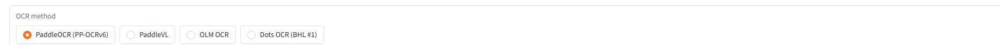
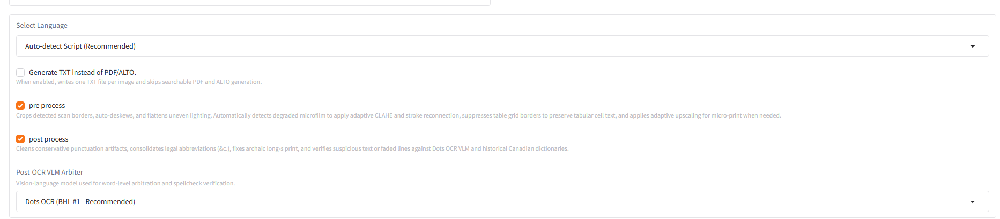

# CRKN OCR Tool User Guide

An intuitive, high-throughput OCR and layout preservation tool developed for the **Canadian Research Knowledge Network (CRKN / RCDR)**. 

---

## 🚀 Running OCR (Step-by-Step)

### Step 1: Launch the Application
Double-click **CRKN OCR Tool** on your desktop (or double-click `Start OCR Tool.bat` in the project folder).


---

### Step 2: Service Initialization
A terminal window will open briefly as background services verify offline pre-cached models and initialize the GPU.


---

### Step 3: Browser Interface
Once initialization completes, your web browser will automatically open **`http://127.0.0.1:7860/`**.


---

### Step 4: Choose the OCR Method



| OCR Method | Best For | Advantages | Outputs Supported |
| :--- | :--- | :--- | :--- |
| **PaddleOCR (PP-OCRv6)** *(Recommended Default)* | Historical broadsheet newspapers, microfilms, monographs, legal deeds, and statistical tables. | Ultra-fast GPU inference (1–2 sec/page). Generates exact word-box coordinates, supports multi-column reading order, micro-print upscaling, table ruling suppression, and VLM arbitration. | **Searchable PDF**, **ALTO XML 4.2**, **JSON**, Plain Text. |
| **Dots OCR (7B VLM)** | Severely degraded scans, damaged historical typography, smudged ink, and complex multi-modal layouts. | State-of-the-art vision-language model with sentence-level semantic understanding. Excellent at recovering faint or damaged text where standard OCR produces gibberish. | Formatted Text, Markdown, Audit Log. |
| **PaddleVL** | Multimodal whole-page layout parsing with complex interleaved tables and ads. | Uses visual context for dense ads and complex visual blocks. | Page Text, Layout Blocks. |
| **OLM OCR** | Rough historical scans, irregular layouts, and mixed printed/handwritten documents. | Natural reading order synthesis using vision LLM. | Reading-Order Text, Markdown. |

> [!TIP]
> **Which engine should I pick?**
> * For **95% of archival workflows**: Use **PaddleOCR (PP-OCRv6)**. It is fast, accurate, and produces production-ready **Searchable PDFs** and **ALTO XML 4.2** with exact 1:1 pixel coordinate alignment.
> * If a page is severely faded or damaged and regular OCR struggles: Try **Dots OCR** or **OLM OCR**.

---

### Step 5: Select Folders


1. **Image Input Folder**: Enter or browse to the folder containing your scans (e.g. `C:\Users\blapierre\Documents\PDF Test\Newspapers\ome.00003_19290103`). If the input folder contains multiple subfolders, the tool will queue them up automatically in order.
2. **Output Folder**: Enter or browse to where you want the resulting PDFs, ALTO XML, and text files saved (e.g. `C:\Users\blapierre\Desktop\PDF Test - Final`).

---

### Step 6 & 7: Language Selection and Master Processing Toggles



#### Language Selection
* **`Auto-detect Script (Recommended)` (Default)**:
  * **Leave this on `Auto-detect Script` for most jobs!** The engine automatically examines your folder and files:
    * Dispatches **Traditional Chinese (`chinese_cht`)** for Chinese-Canadian broadsheets (e.g. *The Chinese Times* / 《大漢公報》).
    * Dispatches **Bilingual French superset (`fr`)** for Canadian federal records (StatCan annuals, RCMP forms, Parliamentary Hansard, Québec archives), preventing accent mangling (`"Tlcopieur"` $\rightarrow$ `"Télécopieur"`).
    * Defaults to **English (`en`)** for standard serials and monographs.
* **Manual Language Selection**:
  * If digitizing a specific historical diaspora run, key Canadiana historical languages are pinned right at the top of the dropdown:
    * `Ukrainian (Українська - Prairie Press)`
    * `German (Deutsch - e.g. Berliner Journal)`
    * `Gaelic / Irish (Gàidhlig/Gaeilge - e.g. Mac-Talla)`
    * `Italian (Italiano)`
    * `Latin (Latina - Parish / Church Records)`
    * `Polish (Polski)`, `Russian (Русский)`, `Icelandic (Íslenska)`, `Japanese (日本語)`...

#### Master Processing Toggles
| Toggle | What It Does | When to Check It |
| :--- | :--- | :--- |
| **`pre process`** | **Adaptive Archival Enhancement**: Crops black microfilm borders (preserving pixel offsets), boosts dynamic contrast (CLAHE), reconnects broken letter strokes ($2\times 2$ morphological closing), straightens tilt (deskew), suppresses table ruling lines, and dynamically upscales micro-print ($< 18\text{px}$) by $1.5\times$ with coordinate inversion. | **Recommended ON** for all historical microfilms, yellowed broadsheets, and newspaper scans. |
| **`post process`** | **Visual & Linguistic Arbitration**: Evaluates degraded text lines ($< 0.78$ score) and delegates them to **Dots OCR 7B**. Merges split contractions (`&c.`) and abbreviations (`No.`, `Co.`), re-attaches orphan punctuation, fixes archaic long-s (`ſ` $\rightarrow$ `s`), and restores French accents against the Canadiana Historical Gazetteer. | **Recommended ON** for production preservation output. Turn off only for quick test drafts. |

---

### Step 8: Click Run OCR

Click **Run OCR** to start processing.

Progress will stream directly into the **OCR Output** log:


When processing completes, you will see:
```text
OCR Completed, please check pdf and alto files at your output folder
```


---

## 📁 Output Files Explained

In your designated output folder, the pipeline generates:

1. **`.pdf` (Searchable PDF)**: Contains an invisible text layer behind the original high-resolution scan. Words match original page coordinates with sub-pixel precision.
2. **`.xml` (ALTO XML 4.2)**: Library of Congress preservation standard with exact `<TextBlock>`, `<TextLine>`, and `<String>` tokens organized in natural multi-column reading order.
3. **`.json`**: Normalized OCR geometry containing bounding box coordinates and confidence scores.
4. **`.txt`** *(if selected)*: Clean plain text with preserved column-aware line breaks.
5. **`.post_ocr_vl.csv`**: Audit log recording every word or line reviewed and corrected by Dots OCR 7B.

---

## 📊 Quality Verification & ABBYY Comparison Dashboard

To inspect the OCR quality against baseline ABBYY FineReader outputs, staff can open `compare/index.html` in any web browser:


Clicking on any page opens the interactive **Side-by-Side Diff Viewer**, highlighting exact word matches, discrepancies, and dictionary win rates:


---

## 🛑 Stopping the Tool

When finished for the day, click **Stop CRKN OCR Tool** from the Start Menu (or run `Stop OCR Tool.bat`):


---

## ❓ Troubleshooting

### The browser doesn't open or shows "Connection Refused"
1. Close your browser tab.
2. Run **Stop CRKN OCR Tool** from the Start menu.
3. Double-click **CRKN OCR Tool** on your desktop to restart.

### How to send logs to support
If you encounter an issue, copy and send the log files from:
```text
C:\ProgramData\CRKN OCR Tool\logs
```

